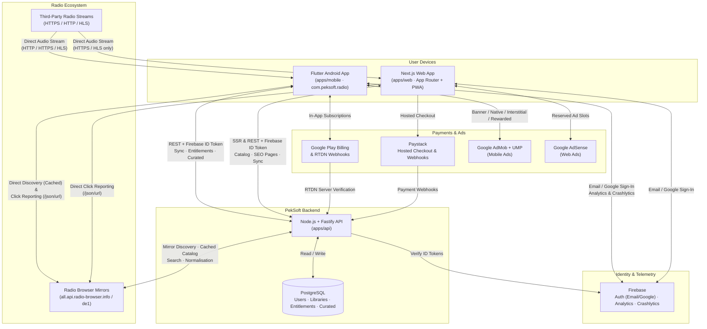

# System Architecture — PekSoft Radio Browser

## Overview
PekSoft Radio Browser uses a **client–gateway–directory** architecture:
- **Audio streams** flow directly from third-party radio broadcasters to the user's device (mobile or browser) — our backend **never** proxies, records, or rebroadcasts audio.
- **Metadata & discovery** are cached and normalised by `apps/api` (for web and shared collections) and queried respectfully from Radio Browser mirrors.
- **Play click attribution** is sent directly from clients to Radio Browser so per-IP 24h counting remains accurate.
- **Auth, library sync, and entitlements** are unified through Firebase Authentication and our Node.js/Fastify API backed by PostgreSQL.

## System Diagram

## Key Architectural Boundaries
1. **No audio proxying**: `apps/mobile` plays HTTP, HTTPS, and HLS streams directly via `just_audio` (with Android cleartext config for HTTP streams). `apps/web` plays HTTPS/HLS streams directly and marks HTTP-only stations as *"Best in the mobile app"*.
2. **Server-side entitlement truth**: Neither `apps/mobile` nor `apps/web` unlocks Plus features locally without verified state from `apps/api` (backed by Play RTDN and Paystack webhooks in PostgreSQL).
3. **Shared contracts & tokens**: `packages/shared` holds Zod schemas and Radio Browser fixtures; `packages/design-tokens` drives both Flutter `ThemeData` and Next.js Tailwind CSS variables.
