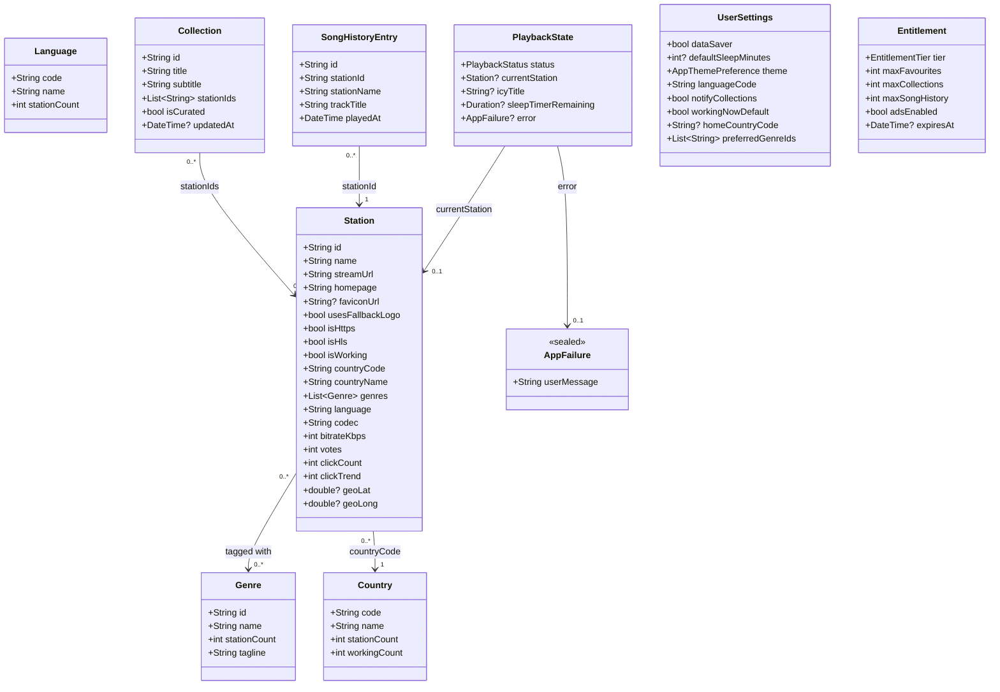

# Mobile Domain Model — PekSoft Radio Browser

All mobile domain models are immutable `@freezed` value objects with zero dependency on Flutter UI, Dio DTOs, or Drift database tables.

## Failure & Result Model

Repositories return `Result<T>` (`Success<T>` | `Failure<T>`), mapping transport, mirror, stream, storage, or entitlement errors into the sealed `AppFailure` hierarchy:

- `NetworkFailure` (with optional `statusCode`)
- `TimeoutFailure`
- `MirrorUnavailableFailure`
- `StreamPlaybackFailure`
- `StorageFailure`
- `NotFoundFailure`
- `ValidationFailure`
- `EntitlementRequiredFailure`
- `UnknownFailure`
